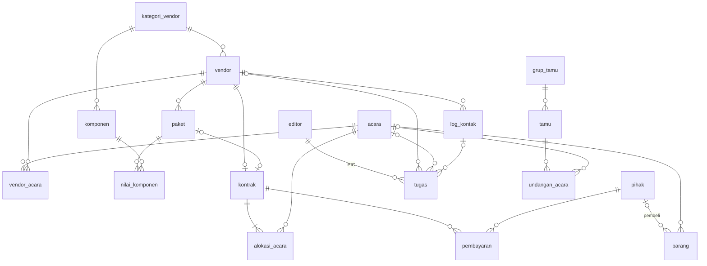

# Data Model

Entitas dan relasinya. Istilah mengikuti [CONTEXT.md](../CONTEXT.md). Nama tabel dan kolom memakai bahasa Indonesia `snake_case` supaya sama dengan istilah domain.

Semua tabel punya kolom audit berikut, tidak diulang di setiap tabel:

| Kolom | Tipe |
|---|---|
| `id` | uuid, primary key |
| `dibuat_pada` | timestamptz |
| `dibuat_oleh` | uuid, ke `editor` |
| `diubah_pada` | timestamptz |
| `diubah_oleh` | uuid, ke `editor` |

Nominal uang disimpan sebagai `bigint` dalam Rupiah penuh, tanpa desimal.

## Diagram relasi

## Fase 1

### `editor`
Diisi saat login pertama. Hanya email yang ada di allowlist yang bisa membuat baris.

| Kolom | Tipe | Catatan |
|---|---|---|
| `auth_user_id` | uuid | ke `auth.users` Supabase |
| `email` | text | unik |
| `nama` | text | "Rendy", "Dinar" |
| `pihak_id` | uuid | Pihak yang mewakili Editor ini |

### `pihak`
| Kolom | Tipe | Catatan |
|---|---|---|
| `nama` | text | Default: Rendy, Dinar, Keluarga Pria, Keluarga Wanita, Lainnya |
| `urutan` | int | urutan tampil |
| `arsip` | boolean | Pihak yang sudah dipakai di Pembayaran tidak bisa dihapus, hanya diarsipkan |

### `acara`
| Kolom | Tipe | Catatan |
|---|---|---|
| `nama` | text | |
| `jenis` | enum | `lamaran`, `akad`, `resepsi`, `ngunduh_mantu`, `lainnya` |
| `tanggal` | date, nullable | null berarti Tanggal belum pasti |
| `perkiraan` | text, nullable | contoh "pertengahan 2027", dipakai saat `tanggal` null |
| `lokasi` | text, nullable | |
| `catatan` | text, nullable | |

### `kategori_vendor`
| Kolom | Tipe | Catatan |
|---|---|---|
| `nama` | text | unik |
| `urutan` | int | |
| `arsip` | boolean | Kategori yang sudah dipakai Vendor tidak bisa dihapus |

### `komponen`
Butir pembanding per kategori untuk Komparasi.

| Kolom | Tipe | Catatan |
|---|---|---|
| `kategori_vendor_id` | uuid | |
| `nama` | text | contoh "Durasi", "Jumlah fotografer" |
| `tipe` | enum | `teks`, `angka`, `ya_tidak` |
| `satuan` | text, nullable | contoh "jam", "pax" |
| `urutan` | int | urutan baris di Komparasi |

### `vendor`
| Kolom | Tipe | Catatan |
|---|---|---|
| `nama` | text | |
| `kategori_vendor_id` | uuid | |
| `status` | enum | `kandidat`, `survei_nego`, `booked`, `selesai`, `batal` |
| `nama_kontak` | text, nullable | |
| `whatsapp` | text, nullable | format `62xxxxxxxxxx` untuk link `wa.me` |
| `instagram` | text, nullable | |
| `link` | text, nullable | |
| `catatan` | text, nullable | |

### `vendor_acara`
Relasi banyak ke banyak.

| Kolom | Tipe |
|---|---|
| `vendor_id` | uuid |
| `acara_id` | uuid |

Primary key gabungan `(vendor_id, acara_id)`.

### `paket`
| Kolom | Tipe | Catatan |
|---|---|---|
| `vendor_id` | uuid | |
| `nama` | text | |
| `harga` | bigint | |
| `syarat_dp` | text, nullable | contoh "DP 30%, pelunasan H-14" |
| `lain_lain` | text, nullable | isi yang tidak masuk Komponen |
| `catatan` | text, nullable | |
| `status` | enum | `aktif`, `dipilih`, `tidak_dipilih` |
| `lampiran` | text[] | path file di Storage |

### `nilai_komponen`
| Kolom | Tipe | Catatan |
|---|---|---|
| `paket_id` | uuid | |
| `komponen_id` | uuid | |
| `nilai` | text | disimpan sebagai teks, ditampilkan sesuai `komponen.tipe` |

Unik `(paket_id, komponen_id)`. Komponen dari kategori lain tidak boleh diisi untuk Paket ini.

### `kontrak`
| Kolom | Tipe | Catatan |
|---|---|---|
| `vendor_id` | uuid | unik, satu Kontrak per Vendor |
| `paket_id` | uuid, nullable | Paket Terpilih, null kalau Kontrak dibuat tanpa Paket |
| `tanggal_kesepakatan` | date, nullable | |
| `lampiran` | text[] | |
| `catatan` | text, nullable | |

Kontrak tidak menyimpan total. Total dihitung dari `alokasi_acara`.

### `alokasi_acara`
Harga Kontrak untuk satu Acara.

| Kolom | Tipe | Catatan |
|---|---|---|
| `kontrak_id` | uuid | |
| `acara_id` | uuid | harus termasuk Acara Vendor tersebut di `vendor_acara` |
| `nominal` | bigint | |
| `catatan` | text, nullable | contoh "termasuk transport ke Bandung" |

Unik `(kontrak_id, acara_id)`. Setiap Kontrak minimal punya satu baris.

### `pembayaran`
| Kolom | Tipe | Catatan |
|---|---|---|
| `kontrak_id` | uuid | |
| `jenis` | enum | `dp`, `termin`, `pelunasan` |
| `nominal` | bigint | |
| `status` | enum | `terjadwal`, `dibayar` |
| `jatuh_tempo` | date, nullable | wajib kalau `terjadwal` |
| `tanggal_bayar` | date, nullable | wajib kalau `dibayar` |
| `pihak_id` | uuid, nullable | wajib kalau `dibayar` |
| `bukti` | text[] | path file di Storage |
| `catatan` | text, nullable | |

### `log_kontak`
| Kolom | Tipe | Catatan |
|---|---|---|
| `vendor_id` | uuid | |
| `tanggal` | date | |
| `saluran` | enum | `whatsapp`, `telepon`, `bertemu`, `email`, `lainnya` |
| `isi` | text | |

### `tugas`
| Kolom | Tipe | Catatan |
|---|---|---|
| `judul` | text | |
| `catatan` | text, nullable | |
| `pic_id` | uuid | ke `editor` |
| `jatuh_tempo` | date, nullable | Tugas tanpa Jatuh Tempo tidak muncul di dashboard |
| `status` | enum | `belum`, `selesai` |
| `selesai_pada` | timestamptz, nullable | |
| `vendor_id` | uuid, nullable | |
| `acara_id` | uuid, nullable | |
| `log_kontak_id` | uuid, nullable | asal Tugas follow-up |

### `share_link`
| Kolom | Tipe | Catatan |
|---|---|---|
| `token` | text | acak 32 byte, unik |
| `label` | text | contoh "Keluarga Dinar" |
| `bagian` | text[] | subset dari `acara`, `vendor`, `tugas`, `keuangan`, dan nanti `tamu`, `barang` |
| `dicabut_pada` | timestamptz, nullable | link aktif kalau null |

## Nilai turunan

Nilai berikut dihitung, tidak disimpan. Bisa dibuat sebagai view Postgres.

| Nilai | Rumus |
|---|---|
| Total Kontrak | jumlah `alokasi_acara.nominal` per `kontrak_id` |
| Terbayar per Kontrak | jumlah `pembayaran.nominal` dengan `status = dibayar` |
| Sisa Tagihan | Total Kontrak dikurangi Terbayar |
| Lunas | Sisa Tagihan `<= 0` |
| Kontribusi per Pihak | jumlah `pembayaran.nominal` yang `dibayar` per `pihak_id`, ditambah (Fase 2) `barang.harga_asli` yang sudah dibeli per `pembeli_pihak_id` |
| Terlambat | `jatuh_tempo < hari ini` dan belum selesai (`tugas.status = belum` atau `pembayaran.status = terjadwal`) |

## Aturan yang dijaga database

- Pembayaran `dibayar` wajib punya `tanggal_bayar` dan `pihak_id`. Pembayaran `terjadwal` wajib punya `jatuh_tempo`.
- Satu Vendor hanya punya satu Paket berstatus `dipilih`.
- Memilih Paket berjalan dalam satu transaksi: ubah status Paket, ubah status Vendor jadi `booked`, buat atau perbarui Kontrak beserta `alokasi_acara`. Kalau Vendor hanya punya satu Acara, satu baris `alokasi_acara` dibuat senilai `paket.harga`.
- Melepas Acara dari Vendor di `vendor_acara` ditolak selama Acara itu masih punya `alokasi_acara` di Kontrak Vendor tersebut.
- Menghapus Vendor yang sudah punya Pembayaran `dibayar` ditolak. Vendor seperti ini hanya bisa ditandai `batal`.

## Fase 2

### `grup_tamu`
| Kolom | Tipe | Catatan |
|---|---|---|
| `nama` | text | Default: Teman Rendy, Teman Dinar, Tamu Orang Tua Pria, Tamu Orang Tua Wanita, Teman Bersama |
| `sisi` | enum | `pria`, `wanita`, `bersama` |
| `urutan` | int | |
| `arsip` | boolean | Grup yang sudah punya Tamu tidak bisa dihapus |

### `tamu`
| Kolom | Tipe | Catatan |
|---|---|---|
| `nama` | text | |
| `grup_tamu_id` | uuid | Sisi Tamu diambil dari grup ini |
| `jumlah_orang` | int | default 1 |
| `whatsapp` | text, nullable | |
| `alamat` | text, nullable | |
| `jenis_undangan` | enum | `fisik`, `digital`, `keduanya` |
| `catatan` | text, nullable | |

### `undangan_acara`
| Kolom | Tipe | Catatan |
|---|---|---|
| `tamu_id` | uuid | |
| `acara_id` | uuid | |
| `status_kirim` | enum | `belum`, `terkirim` |
| `rsvp` | enum | `belum_jawab`, `hadir`, `tidak_hadir`, `mungkin` |
| `jumlah_hadir` | int, nullable | |
| `souvenir_diberikan` | boolean | |

Unik `(tamu_id, acara_id)`.

### `barang`
| Kolom | Tipe | Catatan |
|---|---|---|
| `daftar` | enum | `seserahan`, `mahar`, `hantaran_balasan` |
| `nama` | text | |
| `kategori` | text, nullable | contoh "Perlengkapan ibadah", "Skincare" |
| `anggaran` | bigint, nullable | |
| `harga_asli` | bigint, nullable | |
| `pembeli_pihak_id` | uuid, nullable | |
| `status` | enum | `belum_beli`, `sudah_beli`, `sudah_dihias`, `sudah_diserahkan` |
| `link_toko` | text, nullable | |
| `foto` | text[] | |
| `acara_id` | uuid, nullable | default Resepsi untuk Seserahan, Akad untuk Mahar |

### `anggaran`
| Kolom | Tipe | Catatan |
|---|---|---|
| `acara_id` | uuid, nullable | null berarti lintas Acara |
| `kategori_vendor_id` | uuid, nullable | null untuk baris Barang |
| `daftar_barang` | enum, nullable | diisi untuk anggaran Seserahan, Mahar, atau Hantaran Balasan |
| `nominal` | bigint | |

Realisasi Vendor per Acara diambil dari `alokasi_acara`, jadi Vendor yang dipakai di beberapa Acara tercatat di Anggaran masing-masing Acara sesuai harganya.
